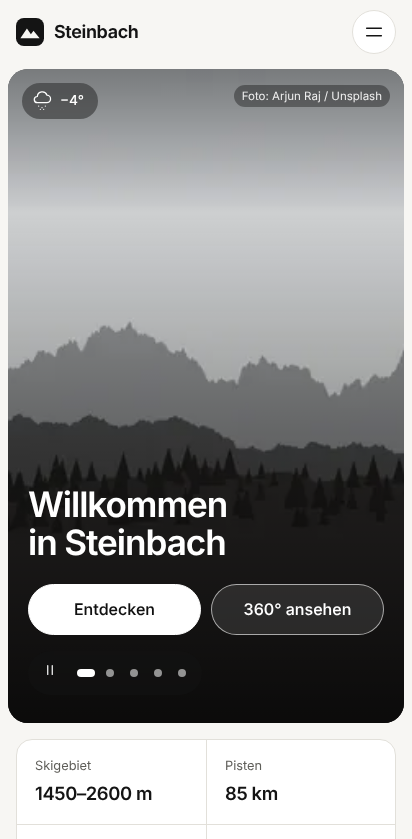
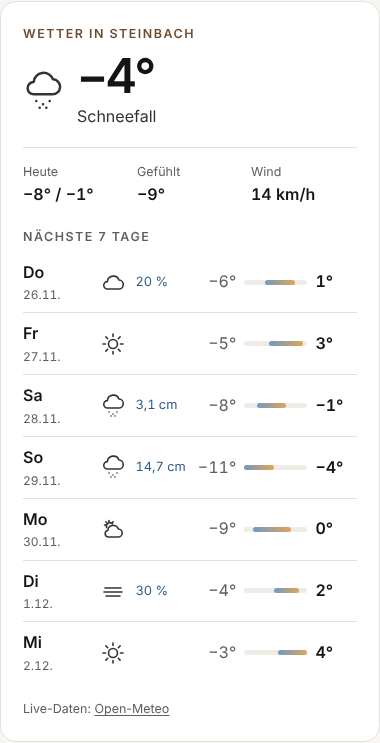
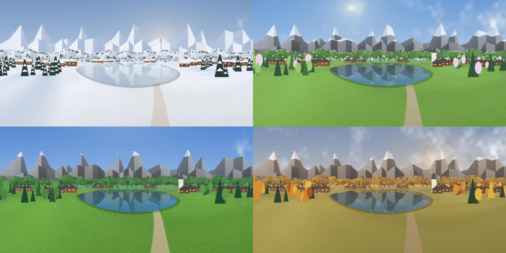

# Steinbach – Website für ein Skidorf

Minimalistisch, schnell, barrierefrei und **mobile first**. Schwarz-Weiss mit ruhigen Naturtönen (Schnee, Stein, Wasser, Holz, Metall), abgerundete Ecken, automatischer Dunkelmodus.

**Enthalten:** Bilder-Karussell · Live-Temperatur mit 7-Tage-Vorschau · 360° in vier Jahreszeiten · Karte mit Wander-, Lauf- und Velorouten und Aussichtspunkten · Dorfleben & Tradition · Ausflugsziele · 360°-Panoramen · Galerie mit Vollbild · YouTube-Videos · Blog · Anreise & Kontakt · Impressum mit Bildnachweis · Sitemap · RSS-Feed

 



Welcher Ordner wofür ist: siehe [directory-structure-explained.md](directory-structure-explained.md).

## Starten

Voraussetzung: Node.js 20 oder neuer. Alle Befehle im Ordner **`main/`** ausführen:

```bash
cd main
npm install
npm start          # http://localhost:3000
npm run dev        # mit automatischem Neustart bei Änderungen
```

Für den Live-Betrieb:

```bash
NODE_ENV=production PORT=3000 SITE_URL=https://www.ihr-dorf.ch npm start
```

`SITE_URL` ist für Sitemap, Teilen-Vorschau (Open Graph) und Suchmaschinen wichtig.

## Inhalte ändern – ohne Programmieren

Alles steht im Ordner `data/`:

| Datei | Inhalt |
|---|---|
| `data/site.json` | Dorfname, **Koordinaten (für Wetter & Karte)**, Karussell-Bilder, Texte, Zahlen, Dorfleben, Kontakt, Anreise |
| `data/media.json` | 360°-Panoramen, Galerie, Videos, Ausflugsziele |
| `data/karte.geojson` | Routen (Wandern, Laufen, Velo) und Aussichtspunkte für die Karte |
| `data/articles/*.md` | Blog-Beiträge |

### Zuerst: Koordinaten des Dorfes eintragen

In Google Maps mit der rechten Maustaste auf den Dorfplatz klicken → die erste Zeile (z. B. `46.60012, 8.20034`) anklicken, sie wird kopiert.
In `data/site.json` unter `location` eintragen:

```json
"location": { "lat": 46.60012, "lon": 8.20034, "label": "Steinbach" }
```

Danach zeigen **Temperatur** und **Karte** automatisch den richtigen Ort.

## Karte mit Routen – direkt aus Google Maps

Die Website hat eine eigene, schnelle Karte mit vier Kategorien, die Besucher ein- und ausblenden können:
**Wandern · Laufen · Velo · Aussicht & Sehenswertes**. Jede Route hat einen Knopf „In Google Maps öffnen“ –
damit startet auf dem Handy direkt die Navigation zum Startpunkt.

Ein Google-API-Schlüssel ist **nicht nötig** und es entstehen **keine Kosten**.

### So kommen die Routen aus Google in die Website

1. **[Google My Maps](https://www.google.com/maps/d/) öffnen** → „Neue Karte erstellen“.
2. **Vier Ebenen anlegen** und genau so benennen: `Wandern`, `Laufen`, `Velo`, `Aussicht`
   (auch „Wanderwege“, „Bike“, „Sehenswürdigkeiten“ usw. werden erkannt).
3. In jeder Ebene **Linien zeichnen** (Routen) bzw. **Markierungen setzen** (Aussichtspunkte, Kirche, Fussballplatz …).
   Name und Beschreibung eintragen – sie erscheinen später in der Website.
   *Tipp:* Fertige Touren aus Komoot, Strava oder Garmin lassen sich als GPX in eine Ebene importieren.
4. Menü **⋮ → „In KML/KMZ exportieren“** → Häkchen bei **„Als KML-Datei exportieren (statt KMZ)“** → Download.
5. Im Ordner `main/`:

   ```bash
   npm run karte -- C:\Users\Name\Downloads\Steinbach.kml
   ```

   Fertig – Seite neu laden. Die alte Karte wird automatisch als `data/karte.backup.geojson` gesichert.

Einzelne GPS-Touren direkt hinzufügen:

```bash
npm run karte -- morgenrunde.gpx --kategorie laufen --hinzufuegen
```

### Zusätzlich die Google-Karte selbst zeigen (optional)

In Google My Maps: **Teilen** → „Jeder mit dem Link kann ansehen“. In der Adresse steht `mid=XXXXXXXX`.
Diese Zeichen in `data/site.json` unter `map.googleMyMapsId` eintragen. Über der Karte erscheint dann der Umschalter
**„Unsere Karte / Google Maps“**.

## Wetter: heute und die nächsten 7 Tage

Oben links im Startbild steht die aktuelle Temperatur. Im Bereich unter den Zahlen zeigt die Wetterkarte
Temperatur, Wetter, Tiefst-/Höchstwert, gefühlte Temperatur und Wind für heute – und darunter die **nächsten 7 Tage**
mit Symbol, Niederschlag bzw. Neuschnee in cm und einem Temperaturbalken.

Die Daten kommen von [Open-Meteo](https://open-meteo.com) für die Koordinaten in `data/site.json`.
Der Server fragt höchstens alle 10 Minuten ab und speichert das Ergebnis – die Website bleibt schnell, auch bei vielen Besuchern.
Fällt der Wetterdienst aus, wird der Wetterbereich einfach ausgeblendet.

> Open-Meteo ist für nicht-kommerzielle Nutzung kostenlos. Für eine offizielle Tourismus-Website ggf. ein günstiges [API-Abo](https://open-meteo.com/en/pricing) prüfen.

### Neuen Blog-Artikel schreiben

Neue Datei in `data/articles/` anlegen, z. B. `2026-12-20-weihnachtsmarkt.md`:

```markdown
---
title: Weihnachtsmarkt auf dem Dorfplatz
date: 2026-12-20
excerpt: Kurzer Text für die Übersicht.
image: /images/gallery/bild-04
category: Dorf
---

Hier steht der Text. **Fett**, Listen, [Links](/info) und ## Zwischentitel gehen alle.
```

Der Artikel erscheint sofort unter `/blog/weihnachtsmarkt` – kein Neustart nötig. Mit `draft: true` bleibt er unsichtbar.

### Fotos

Aktuell sind **Beispielfotos von Unsplash** eingebaut (Schnee, Bergsee, Holzhütten, Kirche, Advent, Akkordeon, Fussballplatz).
Sie werden direkt vom Unsplash-CDN in passender Grösse geladen. Ein Foto ersetzen: in `data/site.json` bzw. `data/media.json`
bei `src` / `image` eine andere Unsplash-Adresse (`https://images.unsplash.com/photo-…`) oder ein eigenes Foto eintragen.
Lädt ein Foto nicht, zeigt die Website automatisch ein Ersatzbild. Bildnachweis: `copyright/bildnachweis.md`.

Die **5 Bilder im Karussell** stehen in `data/site.json` unter `hero.slides`.

### Eigene Fotos

1. Fotos in `data/fotos/galerie`, `data/fotos/orte` oder `data/fotos/blog` legen
2. Im Ordner `main/`: `npm run bilder` – erzeugt automatisch schnelle WebP-Grössen
3. Den angezeigten Pfad (z. B. `/images/galerie-eigene/skilift`) in `data/media.json` eintragen

### 360° in vier Jahreszeiten

Der Rundblick zeigt denselben Ort in **Winter, Frühling, Sommer und Herbst**; beim Öffnen ist automatisch die aktuelle
Jahreszeit ausgewählt. Die vier Panoramen sind **gerenderte Illustrationen** (keine Fotos), erzeugt mit
`main/scripts/panorama_jahreszeiten.py`. Sie sind Platzhalter, bis eigene 360°-Fotos vorhanden sind.

### Eigene 360°-Panoramen

Tipp: dasselbe 360°-Foto vom selben Standort viermal im Jahr aufnehmen und die vier Einträge in `data/media.json` → `panoramas` ersetzen.

Ein 360°-Foto im Format 2:1 (äquirektangular, so wie es die meisten 360°-Kameras und Handy-Apps speichern) als JPG nach `main/public/images/panorama/` kopieren und in `data/media.json` unter `panoramas` eintragen. Empfohlen: 6000 × 3000 Pixel, unter 8000 Pixel Breite (Handys).

### YouTube-Videos

In `data/media.json` unter `videos` die 11-stellige ID aus dem YouTube-Link eintragen
(`https://www.youtube.com/watch?v=`**`aqz-KE-bpKQ`**). Die Beispiel-Videos sind Platzhalter – bitte ersetzen.

## Technik

- **Node.js + Express 5**, serverseitig gerendert – kein Build-Schritt, sehr wenig JavaScript im Browser
- **Mobile first**: Grundgestaltung fürs Handy, grössere Bildschirme werden ergänzt
- **Leaflet** für die Karte (wird erst geladen, wenn man zur Karte scrollt), OpenStreetMap-Kartenbilder
- **Pannellum** für 360° (wird erst beim Klick geladen)
- Fotos über das **Unsplash-CDN** in AVIF/WebP, mit Ersatzbild bei Ausfall
- YouTube im **Datenschutzmodus** (`youtube-nocookie.com`), lädt erst beim Abspielen
- Schrift **Inter** vom eigenen Server, keine Cookies, kein Tracking
- Sicherheits-Header (CSP, Helmet), Gzip-Kompression, langes Caching mit Versionierung
- Funktioniert auch ohne JavaScript

Vollständige Liste: [docs/01_skills-used/skills.txt](docs/01_skills-used/skills.txt) · Lizenzen: [copyright/](copyright/third-party-licenses.md)

## Tests

Die Tests liegen in `tests/`, gestartet werden sie aus `main/`:

```bash
cd main
npm test               # alles
npm run test:unit      # Server, Inhalte, Sicherheit (node:test)
npm run test:e2e       # echte Browser, Desktop + Handy (Playwright + axe)
```

Für die Browser-Tests einmalig `npx playwright install chromium` ausführen (oder Google Chrome installiert haben).

Geprüft werden u. a.: **jeder Menüeintrag auf Handy und Desktop**, alle Footer-Links, alle Seiten und Artikel, Aufbau des Startbilds, 7-Tage-Wetter, kaputte Bilder und Links, Barrierefreiheit (WCAG 2.1 AA), Handy-Menü, Karussell (automatisch, Punkte, Pause, Wischen), Wetter (inkl. Ausfall), Karte (Filter, Popups, Google-Links), KML/GPX-Import, 360°-Viewer, Lightbox, Video-Laden, Ersatzbilder, 404, Funktion ohne JavaScript, Sicherheits-Header, Ladezeit.
Externe Dienste (Fotos, Kartenbilder, Wetter, YouTube) werden in den Tests durch lokale Daten ersetzt – die Tests laufen auch ohne Internet.

## Platzhalter-Bilder neu erzeugen (optional, Python)

```bash
python -m pip install -r draft_requirements_python-3.11.9.txt
cd main
python scripts/panorama_jahreszeiten.py public/images/panorama   # 360° Winter/Frühling/Sommer/Herbst
python scripts/platzhalter_bilder.py public/images               # übrige Platzhalter
```
