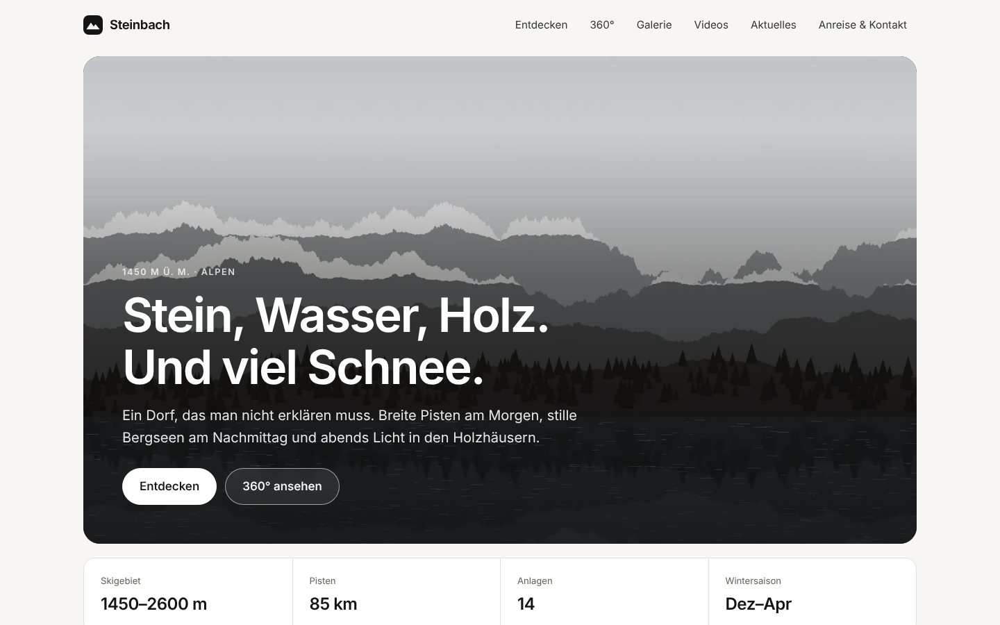

# Steinbach – Website für ein Skidorf

Minimalistisch, schnell und barrierefrei. Schwarz-Weiss mit ruhigen Naturtönen (Stein, Wasser, Holz, Metall), abgerundete Ecken, automatischer Dunkelmodus.

**Enthalten:** Startseite · Ausflugsziele · 360°-Panoramen · Bildergalerie mit Vollbild · YouTube-Videos · Blog/Aktuelles · Anreise & Kontakt · Impressum · 404-Seite · Sitemap · RSS-Feed



Welcher Ordner wofür ist: siehe [directory-structure-explained.md](directory-structure-explained.md).

## Starten

Voraussetzung: Node.js 20 oder neuer. Alle Befehle im Ordner **`main/`** ausführen:

```bash
cd main
npm install
npm start          # http://localhost:3000
npm run dev        # mit automatischem Neustart bei Änderungen
```

Für den Live-Betrieb:

```bash
NODE_ENV=production PORT=3000 SITE_URL=https://www.ihr-dorf.ch npm start
```

`SITE_URL` ist für Sitemap, Teilen-Vorschau (Open Graph) und Suchmaschinen wichtig.

## Inhalte ändern – ohne Programmieren

Alles steht im Ordner `data/`:

| Datei | Inhalt |
|---|---|
| `data/site.json` | Dorfname, Startseiten-Text, Zahlen, Kontakt, Öffnungszeiten, Anreise |
| `data/media.json` | 360°-Panoramen, Galerie, Videos, Ausflugsziele |
| `data/articles/*.md` | Blog-Beiträge |

### Neuen Blog-Artikel schreiben

Neue Datei in `data/articles/` anlegen, z. B. `2026-12-20-weihnachtsmarkt.md`:

```markdown
---
title: Weihnachtsmarkt auf dem Dorfplatz
date: 2026-12-20
excerpt: Kurzer Text für die Übersicht.
image: /images/gallery/bild-04
category: Dorf
---

Hier steht der Text. **Fett**, Listen, [Links](/info) und ## Zwischentitel gehen alle.
```

Der Artikel erscheint sofort unter `/blog/weihnachtsmarkt` – kein Neustart nötig. Mit `draft: true` bleibt er unsichtbar.

### Eigene Fotos

1. Fotos in `data/fotos/galerie`, `data/fotos/orte` oder `data/fotos/blog` legen
2. Im Ordner `main/`: `npm run bilder` – erzeugt automatisch schnelle WebP-Grössen
3. Den angezeigten Pfad (z. B. `/images/galerie-eigene/skilift`) in `data/media.json` eintragen

### Eigene 360°-Panoramen

Ein 360°-Foto im Format 2:1 (äquirektangular, so wie es die meisten 360°-Kameras und Handy-Apps speichern) als JPG nach `main/public/images/panorama/` kopieren und in `data/media.json` unter `panoramas` eintragen. Empfohlen: 6000 × 3000 Pixel, unter 8000 Pixel Breite (Handys).

### YouTube-Videos

In `data/media.json` unter `videos` die 11-stellige ID aus dem YouTube-Link eintragen
(`https://www.youtube.com/watch?v=`**`aqz-KE-bpKQ`**). Die Beispiel-Videos sind Platzhalter – bitte ersetzen.

## Technik

- **Node.js + Express 5**, serverseitig gerendert – kein Build-Schritt, sehr wenig JavaScript im Browser (≈ 6 KB)
- **Pannellum** für 360° (wird erst beim Klick geladen)
- YouTube im **Datenschutzmodus** (`youtube-nocookie.com`), lädt erst beim Abspielen
- Schrift **Inter** vom eigenen Server, keine Cookies, kein Tracking
- Sicherheits-Header (CSP, Helmet), Gzip-Kompression, langes Caching mit Versionierung
- Funktioniert auch ohne JavaScript

Vollständige Liste: [docs/01_skills-used/skills.txt](docs/01_skills-used/skills.txt) · Lizenzen: [copyright/](copyright/third-party-licenses.md)

## Tests

Die Tests liegen in `tests/`, gestartet werden sie aus `main/`:

```bash
cd main
npm test               # alles
npm run test:unit      # Server, Inhalte, Sicherheit (node:test)
npm run test:e2e       # echte Browser, Desktop + Handy (Playwright + axe)
```

Für die Browser-Tests einmalig `npx playwright install chromium` ausführen (oder Google Chrome installiert haben).

Geprüft werden u. a.: alle Seiten und Artikel, kaputte Bilder und Links, Barrierefreiheit (WCAG 2.1 AA), Handy-Menü, 360°-Viewer inkl. Standortwechsel, Lightbox mit Tastatur, Video-Laden, 404, Funktion ohne JavaScript, Ladezeit.

## Platzhalter-Bilder neu erzeugen (optional, Python)

```bash
python -m pip install -r draft_requirements_python-3.11.9.txt
cd main && python scripts/platzhalter_bilder.py public/images
```
